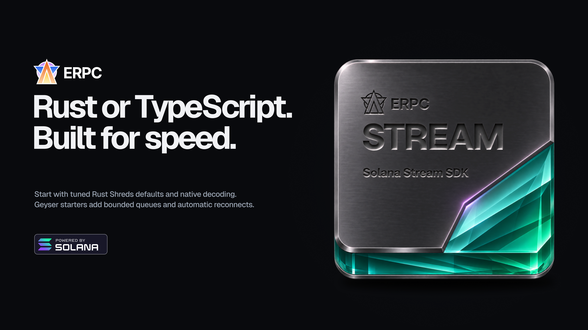

# Solana Stream SDK

[][solana-stream-start]

**Real-time Solana data for Rust and TypeScript.**

Build indexers, monitors, and event-driven applications with **Geyser gRPC**, **Shreds gRPC**, or **UDP Shreds**. One open-source repository with SDKs, working clients, and protocol migration guides.

[](https://crates.io/crates/solana-stream-sdk)
[](https://www.npmjs.com/package/@validators-dao/solana-stream-sdk)
[](LICENSE.txt)

[Choose a stream](#choose-your-stream) · [Quick start](#quick-start) · [Documentation](#documentation) · [Releases](#versions-and-compatibility)

## Choose your stream

| Stream | Best for | Language | Working example |
| --- | --- | --- | --- |
| **Geyser gRPC** | Structured transactions, accounts, slots, and blocks with server-side filters and resilient subscriptions | Rust / TypeScript | [Rust](client/geyser-rs/README.md) · [TypeScript](client/geyser-ts/README.md) |
| **Shreds gRPC** | Receiving and decoding shred-derived entries over a gRPC connection | Rust / TypeScript | [Rust](client/shreds-rs/README.md) · [TypeScript](client/shreds-ts/README.md) |
| **UDP Shreds** | Packet-level Solana data for latency-sensitive custom processing, where packet loss and incomplete data can be handled | Rust | [Receiver](client/shreds-udp-rs/README.md) · [Integration guide](docs/udp-shreds.md) |

**New to Solana streams? Start with Geyser gRPC.** It offers structured updates and supported subscription filters. Choose Shreds when you need the lower-level data path and understand the trade-offs.

This repository contains **client libraries and examples**, not a hosted data service. Bring a compatible stream endpoint or UDP forwarding source. [ERPC](https://dashboard.erpc.global/en) is one option; other compatible providers can be used.

## Quick start

### 1. TypeScript: run the Geyser client

Requires **Node.js 22+** and **pnpm**. The source workspace uses pnpm 11.

```bash
git clone https://github.com/ValidatorsDAO/solana-stream.git
cd solana-stream
pnpm install

cp client/geyser-ts/.env.example client/geyser-ts/.env
# Set GEYSER_ENDPOINT and SOLANA_RPC_ENDPOINT; add X_TOKEN if your provider requires it.

pnpm -F @validators-dao/solana-stream-sdk build
pnpm -F geyser-ts dev
```

The example includes reconnect handling, stream resumption, bounded processing, and transaction/account handlers. [Configuration and application hooks](client/geyser-ts/README.md).

For an existing TypeScript project, install the published library with `pnpm add @validators-dao/solana-stream-sdk`. See the [package API and examples](package/solana-stream-sdk/README.md).

### 2. Rust: run the Shreds gRPC client

Requires **Rust 1.98.1+** and access to a Shreds gRPC endpoint.

```bash
git clone https://github.com/ValidatorsDAO/solana-stream.git
cd solana-stream/client/shreds-rs

cp .env.example .env
# Replace SHREDS_ENDPOINT and SOLANA_RPC_ENDPOINT with your own endpoints.

cargo run
```

For a Rust application, add `solana-stream-sdk = "5.0.0"` to your `Cargo.toml`, then follow the [Shreds example](client/shreds-rs/README.md) or [Geyser example](client/geyser-rs/README.md).

### 3. Rust: receive UDP Shreds

If you have a UDP Shreds source, set the listener in [`settings.jsonc`](client/shreds-udp-rs/settings.jsonc) and forward packets to its IP and port:

```bash
# From the repository root
cargo run -p shreds-udp-rs --bin generic_logger
```

This is a **listener**, not a data-source simulator; output requires incoming packets. The [UDP integration guide](docs/udp-shreds.md) covers configuration, assembly, custom handlers, and signature verification.

## Built for streaming applications

- **Resilient Geyser subscriptions:** Rust `subscribe_with_reconnect` and TypeScript `subscribeWithReconnect` expose disconnections and partial banks, with replay support. Consumers must handle replayed updates idempotently.
- **Modern Solana data formats:** Supports Transaction v1 and Alpenglow block markers; see the [compatibility notes](#versions-and-compatibility).
- **High-throughput Rust gRPC configuration:** Rust SDK 5.0 uses 16 MiB HTTP/2 receive windows for `ShredstreamClient::connect`; use `tune_geyser_grpc_builder` for the upstream Geyser builder.
- **Composable UDP processing:** The Rust `udp` feature offers shred decoding, FEC assembly, deshredding, program watchers, and custom sinks without pulling `solana-ledger` into consumer builds.

[Performance measurements and methodology](docs/performance.md) include the scope and limitations of the published local benchmarks.

## Versions and compatibility

| Package | Published version (as of 2026-11-18) | Notes |
| --- | --- | --- |
| [`solana-stream-sdk`](https://crates.io/crates/solana-stream-sdk) (Rust) | **5.0.0** | UDP decoder migration and Rust gRPC receive-window defaults; [v5 migration](docs/migration-v5.md) |
| [`@validators-dao/solana-stream-sdk`](https://www.npmjs.com/package/@validators-dao/solana-stream-sdk) (TypeScript) | **4.0.0** | `4.1.0` is in the repository source but **not yet published to npm**; npm 4.0 does **not** include the new 16 MiB Geyser defaults |

The two packages **do not share a release version**. Check the package-registry badges above for newer releases. Rust 5.0 requires Rust **1.98.1+**; the repository pins **1.99.1**. TypeScript requires Node.js **22+**.

### Important behavior

- **Shreds gRPC filters are experimental:** Use empty filter maps. Geyser gRPC filters are supported.
- **UDP is not finality:** Packets may be lost or out of order, and observations may contain failed transactions. The sample UDP receive loop does **not verify leader signatures** by default. See [verification guidance](docs/migration-v5.md#leader-signatures).
- **Reconnects may replay data:** Handle `Disconnected` events, discard partial-bank state, and make application processing idempotent.
- **Flow control is not a server-limit bypass:** Larger HTTP/2 receive windows do not fix a slow consumer or override upstream constraints.

## Documentation

| Topic | Guide |
| --- | --- |
| Geyser gRPC | [TypeScript client](client/geyser-ts/README.md) · [Rust client](client/geyser-rs/README.md) |
| Shreds gRPC | [TypeScript client](client/shreds-ts/README.md) · [Rust client](client/shreds-rs/README.md) |
| UDP Shreds | [Integration and operational guide](docs/udp-shreds.md) · [Rust receiver sample](client/shreds-udp-rs/README.md) |
| Protocol upgrades | [Rust v5 migration](docs/migration-v5.md) · [v4 migration](docs/migration-v4.md) · [Alpenglow](docs/alpenglow.md) · [Transaction v1](docs/transaction-v1.md) |
| Performance | [Benchmarks and gRPC flow control](docs/performance.md) |
| SDK packages | [Rust crate](crate/solana-stream-sdk/README.md) · [TypeScript package](package/solana-stream-sdk/README.md) |
| Release history | [Changelog](CHANGELOG.md) · [GitHub releases](https://github.com/ValidatorsDAO/solana-stream/releases) |

## Contributing and support

Issues, fixes, and improvements are welcome. See [Contributing](CONTRIBUTING.md), [Security](SECURITY.md), and the [Code of Conduct](CODE_OF_CONDUCT.md). Report SDK bugs through [GitHub Issues](https://github.com/ValidatorsDAO/solana-stream/issues); for ERPC account or endpoint support, use the [ERPC dashboard](https://dashboard.erpc.global/en).

Maintained by [Validators DAO](https://github.com/ValidatorsDAO). Licensed under [Apache-2.0](LICENSE.txt). [Powered by Solana](https://solana.com/).

The [ERPC key visual](docs/assets/solana-stream-hero.png) is covered by the
[ELSOUL LABO brand notice](LICENSES/LicenseRef-ELSOUL-LABO-Brand.txt).

[solana-stream-start]: #quick-start
